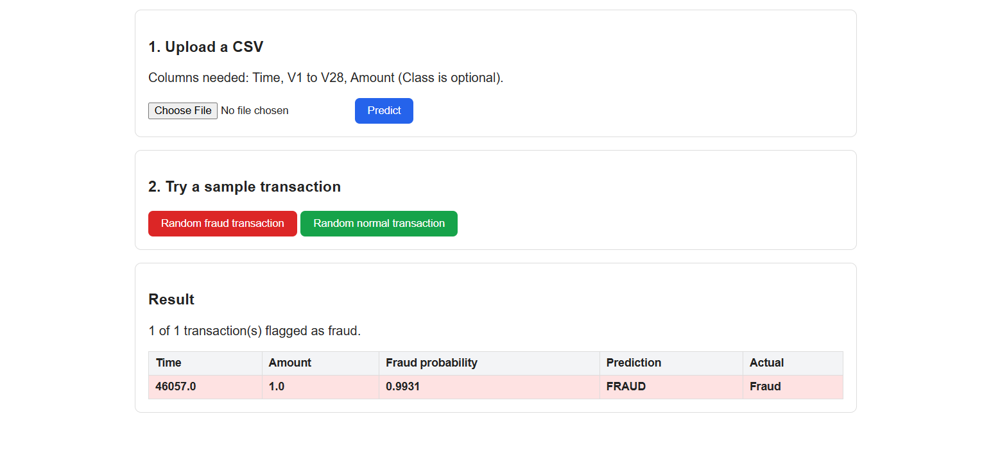
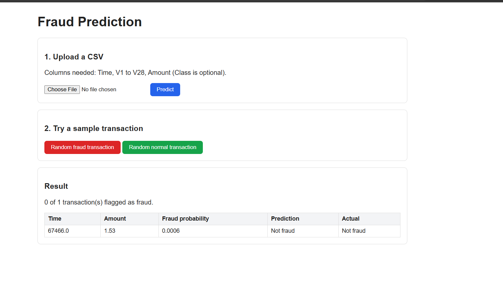

# Credit Card Fraud Detection

Detects fraudulent credit card transactions with an Optuna-tuned XGBoost model, where only **0.17%** of transactions are fraud. Includes EDA, model comparison, a training and prediction pipeline, and a Flask web app.




## Problem Statement

Credit card fraud causes large financial losses, but fraud is rare, so a model that predicts "legitimate" every time already reaches 99.8% accuracy. This project builds a classifier that finds the frauds while keeping false alarms low, and evaluates it with metrics that fit an imbalanced problem.

## Result

Test set: 56,962 transactions, 98 of them fraud (full dataset, stratified 20% split).

| Metric | Score |
|---|---|
| Precision (fraud) | 0.94 |
| Recall (fraud) | 0.74 |
| PR-AUC | 0.82 |
| ROC-AUC | 0.99 |

The model catches **73 of 98 frauds** and raises only **5 false alarms** among 56,864 normal transactions.

| Model (threshold 0.5, before tuning) | PR-AUC | ROC-AUC |
|---|---|---|
| Random Forest | 0.814 | 0.951 |
| LightGBM | 0.824 | 0.978 |
| XGBoost | 0.825 | 0.983 |

The test set has only 98 frauds, so differences of about 0.01 between models are within noise. Scores come from `notebook/creditcardfraud.ipynb`.

## Approach

1. **EDA:** class imbalance, `Amount` and `Time` behaviour, correlations, fraud by hour, VIF check.
2. **Preprocessing:** `log1p` + `RobustScaler` on `Amount`, `RobustScaler` on `Time`, `V1` to `V28` unchanged.
3. **Imbalance:** class weights (`class_weight`, `scale_pos_weight`).
4. **Models:** Random Forest, LightGBM and XGBoost compared on PR-AUC.
5. **Tuning:** XGBoost tuned with Optuna (30 trials, 5-fold stratified CV on PR-AUC).
6. **Threshold:** decision threshold (0.984) chosen from cross-validated training predictions, so the test set is used once, for the final score.
7. **No leakage:** preprocessing and model sit in one scikit-learn pipeline, so scalers are fitted on training data only.
8. **Serving:** Flask app that predicts from an uploaded CSV or a sample transaction.

## Dataset

[Credit Card Fraud Detection (ULB) on Kaggle](https://www.kaggle.com/datasets/mlg-ulb/creditcardfraud): 284,807 transactions, 492 frauds (0.17%). Features are `Time`, `Amount`, anonymized `V1` to `V28` (PCA), and the target `Class` (0 = legitimate, 1 = fraud).

The full file is too big for GitHub, so the repo has a sample at `notebook/data/creditcard_sample.csv` (all 492 frauds + 20,000 normal transactions). To reproduce the reported scores, download `creditcard.csv` from Kaggle and place it in `notebook/data/`.

## Project Structure

```
creditcardfrauddetection/
├── app.py                      # Flask app
├── templates/                  # web pages
├── screenshots/
├── notebook/
│   ├── creditcardfraud.ipynb   # EDA, models, tuning, results
│   └── data/creditcard_sample.csv
├── src/fraud_detection/
│   ├── components/             # ingestion, transformation, model trainer
│   ├── pipelines/              # training and prediction pipelines
│   ├── logger.py
│   ├── exception.py
│   └── utils.py
├── Artifacts/                  # generated data and trained model
├── requirement.txt
└── setup.py
```

## Installation


```bash
git clone https://github.com/<amitk253154-dot>/creditcardfrauddetection.git
cd creditcardfrauddetection
python -m venv venu
venu\Scripts\activate         
pip install -r requirement.txt
```

## Usage

```bash
# 1. Train and save the model (creates Artifacts/fraud_pipeline.pkl)
python -m src.fraud_detection.pipelines.training_pipeline

# 2. Start the web app, then open http://127.0.0.1:5000
python app.py
```

Predict from Python:

```python
from src.fraud_detection.pipelines.prediction_pipeline import PredictPipeline

labels, probabilities = PredictPipeline().predict(df)   # df has Time, V1..V28, Amount
```

## Tech Stack

Python, pandas, NumPy, scikit-learn, XGBoost, LightGBM, Optuna, statsmodels, Matplotlib, Seaborn, Flask

## Limitations

- `V1` to `V28` are anonymized, so predictions can't be explained in business terms.
- The test set has only 98 frauds, so scores carry some uncertainty.
- The demo app uses the sample file, so demo outputs illustrate the app and are not a performance measure.
- The data is from 2013 European cardholders. Fraud patterns change, so a real system needs monitoring and retraining.


## Author

**Amit Kumar** · [GitHub](https://github.com/amitk253154-dot) · [LinkedIn](https://www.linkedin.com/in/your-profile)